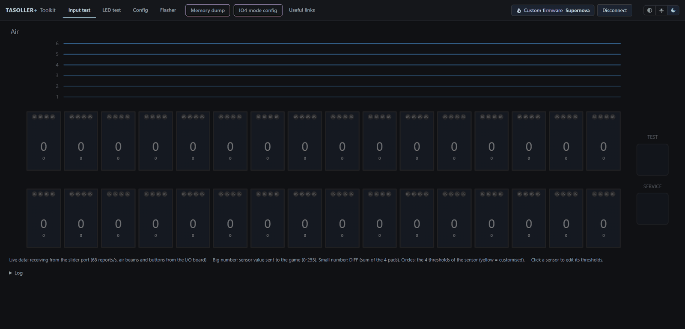

# Tasoller Plus Toolkit

A web page to test, set up and update your Tasoller Plus. It runs in your browser, there is nothing to install.

It works with the **official firmware**: see the sensors live, test the LEDs, change the settings and update the firmware.
It is also **the official tool for installing and configuring Supernova**, the custom firmware for the Tasoller Plus: once the
device runs Supernova, the extra features show up as purple tabs and buttons.

## What you can do

- **Input test**: the air beams, the buttons and the 32 pads, live.
- **LED test**: light up the LEDs of the slider and of the air towers to check them.
- **Config**: the USB mode, the sensitivity, the brightness and the keys.
- **Flasher**: install a firmware update, Supernova included.
- With **Supernova**: **Memory dump**, **IO4 mode config** and the backup of the settings (purple).
- **Useful links**.

The page follows the light or dark theme of your system. The buttons at the top right change it.

## Getting started

1. Open `release/index.html` in Chrome or Edge on a computer (other browsers cannot talk to the device).
2. Close the official tool and the game, they use the device.
3. Press **Connect**, pick the device in the list and allow what the page asks for.

## Build

Run `build.cmd` (Windows, [Python 3](https://www.python.org/) needed, nothing else). The result is `release/index.html`.

That file works fully offline and can be shared as it is: it is the whole tool in one file.

Technical notes for developers (how the page talks to the device, the layout of the sources) are in [docs/DEVELOPMENT.md](docs/DEVELOPMENT.md).
